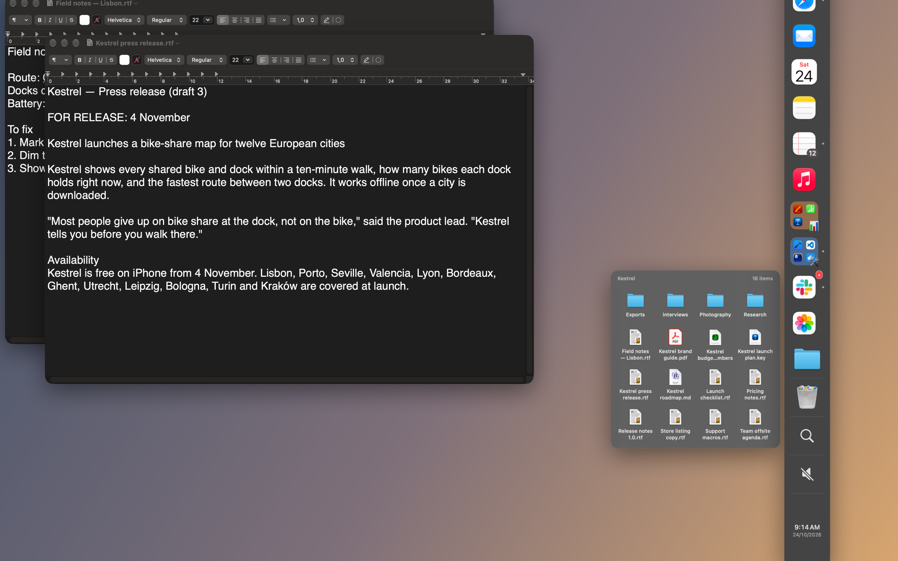

A folder stack is a pinned folder. Click it and its contents open on a grid beside the bar.

## When to use it

- You open the same folders every day, such as Downloads or a project.
- You want to reach a file without opening a Finder window.

## How to use it

### Pin a folder

1. In Finder, drag a folder onto the bar. Drop it on an app row or anywhere else on the bar.
2. The folder appears as a row, with its name.

Drop several folders at once and each becomes a stack. If you drop folders together with files, the files open in the app you dropped on. Hold <kbd>⌥</kbd> to open folders in that app instead of pinning them.

### Open a stack

1. Click the folder row. Or rest the pointer on it for 0.4 seconds.
2. Click a file to open it in its usual app.
3. Click a subfolder to open it in Finder.

Folders are listed first, then files. A stack shows at most 60 items, and its header shows the count. To turn off the hover preview, switch off **Show folder preview on hover** in Settings > Bar. Clicking still works.

### Change the order

1. Right-click the stack row.
2. Choose **Sort By**, then **Name** or **Date Added**. **Date Added** puts the newest first.

Downloads starts on **Date Added**. Every other folder starts on **Name**.

### Other menu items

Right-click a stack row for **Show Contents**, **Open in Finder**, **Remove from Bar**, **Move Up**, **Move Down** and **Move to End**. Right-click an item inside the stack for **Open** or **Show in Finder**.

### Desktop, Documents and Downloads

The first time Nexus reads one of these, macOS asks whether to allow it. If you refused, the stack says "Nexus needs permission to read this folder" and offers **Open in Finder**. Opening it in Finder lets macOS ask again.

## What it will not do

- It never moves, copies or deletes your files. It only opens them.
- It shows only what macOS lets Nexus read. A folder it cannot read is not shown as empty.
- A stack that points at a folder you moved or deleted says "This folder is no longer there".

## Next steps

- [Applications](applications.md)
- [Groups](groups.md)
- [Tidy a crowded bar](../recipes/tidy-the-bar.md)
- [Privacy and permissions](../reference/privacy-and-permissions.md)
