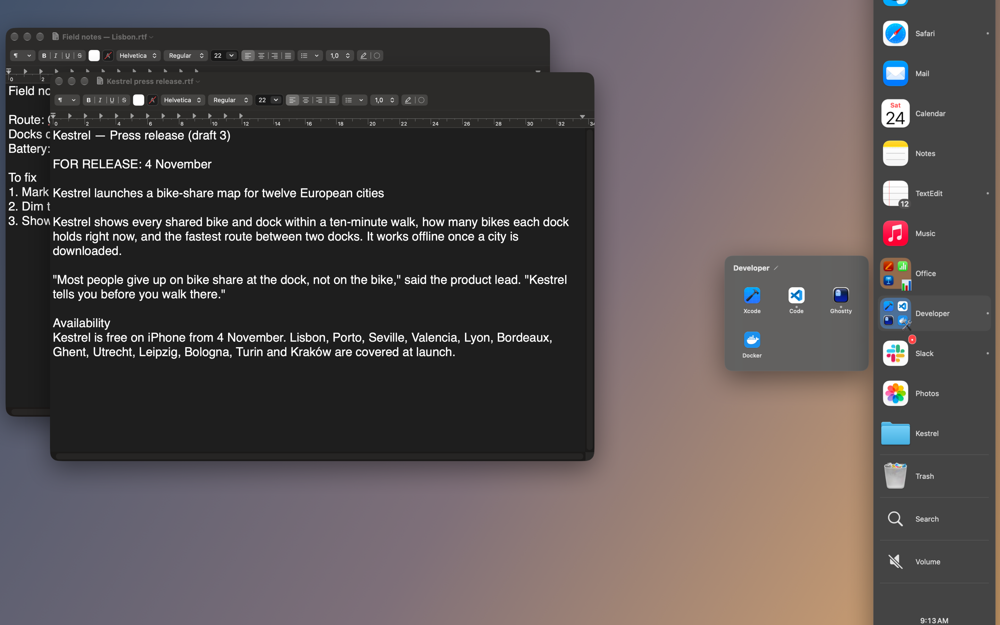

A group puts several apps behind one icon. The icon is a small tile of its members, and clicking it opens them in a popover.

## When to use it

- The bar is too long and you want to fold related apps into one row.
- You want a single place for apps of one kind, such as Developer or Social.

## How to use it

### Make a group

1. Drag an app row onto another app row.
2. Hold it over the middle of that row. The middle groups. The two ends reorder instead.
3. Let go. The two apps become a group in that place.

To add another app, drag it onto the group the same way. A group holds 9 apps by default.

### Name it

Nexus names a new group by the category most of its apps declare, for example **Developer**, **Social** or **Productivity**. If the apps declare none, it uses their names, such as "Chrome & Brave", or "Chrome & 2 more" for more than two.

To rename:

1. Click the group to open it.
2. Click its name at the top of the popover and type a new one. Press Return.

You can also right-click the group and choose **Rename…**.

### Colour and emoji

1. Open the group and click its name to edit it.
2. Pick a colour swatch, or type an emoji in the **emoji** field.

A colour can also be set from the right-click menu under **Colour**, which has **None** and a list of colour names. If you do not see these, turn on **Group colours and emoji** in Settings > Bar. Turning it off hides them without forgetting them.

### Grid or list

In Settings > Behavior, **Opened group shows** has two choices:

- **Icons** shows the apps as a grid.
- **A list** shows one row per app, icon beside name.

### Group size

**Applications per group** in Settings > Behavior is **9 (3 × 3)** or **16 (4 × 4)**. A group that is full does not accept more apps.

### Use a group

- Click an app inside the popover to open it. Right-click it for **Open** or **Remove from Group**.
- Drag an app out of the popover onto the bar to take it out of the group.
- Rest a dragged app on a group for a moment and the group opens. You can then drop the app on a member to put it at that place.
- Right-click the group for **Open Group**, **Rename…**, **Colour**, **Ungroup**, **Remove Group**, **Move Up**, **Move Down** and **Move to End**.

**Ungroup** puts the apps back on the bar in the group's place. **Remove Group** unpins the group. A group left with one app dissolves into that app.

### Suggestions by category

Turn on **Suggest groups by category** in Settings > Bar. When you pin an app whose category already has a group, it joins that group, and its right-click menu offers **Add to** followed by the group's name. Nexus creates nothing on its own. It is off by default.

### Make a group from the window switcher

The window switcher can turn the apps of selected windows into a group with **Add Stack**. See [Window switcher](../windows/window-switcher.md).

## What it will not do

- A group holds apps only, not folders or files.
- An app can be in one group at a time.
- Dock badges show on a group when any member has one, and need Accessibility.

## Next steps

- [Applications](applications.md)
- [Tidy a crowded bar](../recipes/tidy-the-bar.md)
- [Window switcher](../windows/window-switcher.md)
- [Settings](../reference/settings.md)
