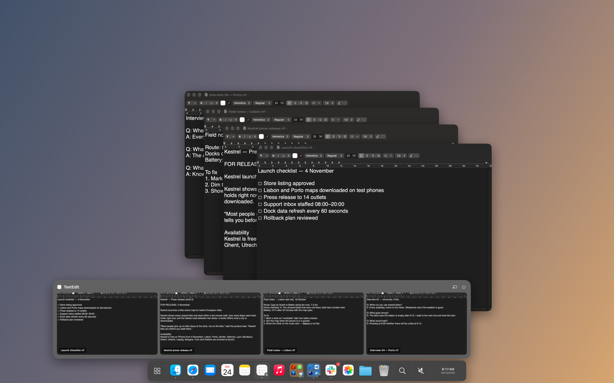

The bar can sit on any edge of the screen, hide until you need it, and appear on one display or all of them.

## When to use it

- The bar is in your way, or you want it on another edge.
- You use more than one display.
- You want a smaller, lighter bar.

## How to use it

### Choose an edge

1. Open Settings and click **Dock**.
2. Under **Position**, choose **Left**, **Right**, **Top** or **Bottom**.

The bar moves right away. On the top and bottom edges the bar runs sideways, and **Expand on hover** does not apply.

### Size and look

Open Settings > Appearance and use the sliders:

- **Sidebar width**
- **Icon size**
- **Icon spacing**
- **Corner radius**
- **Opacity**

### Auto-hide

1. Open Settings > Behavior and turn on **Auto-hide the sidebar**.
2. Set **Hide delay** to how long the bar waits before hiding. It is 0.4 seconds by default.
3. Move the pointer to the screen edge to bring the bar back.

### Hover expand

**Expand on hover** in Settings > Behavior widens a left or right bar to show app names while the pointer is on it.

### Several displays

In Settings > Dock, **Display** has three choices:

- **Main display** puts the bar on the main display only.
- **Display with the pointer** moves the bar to whichever display the pointer is on.
- **Every display** gives each display its own bar, all showing the same apps.

### Full-screen apps

**Hide over full-screen apps** in Settings > Bar is on by default. A display showing a full-screen app shows no bar. A bar on another display stays.

### Keep windows clear of the bar

**Keep windows off Nexus** in Settings > Behavior moves windows that overlap the bar out from under it. It is off by default, needs Accessibility, and cannot be used with auto-hide. Full-screen windows are left alone.

### Bar zones and length

The bar has a fixed top, a middle that scrolls, and a fixed end. The end holds the Trash, Search, volume and clock, and stays in view. In Settings > Bar, **Most pinned rows** and **Most running rows** cap how many rows each part of the middle shows before it scrolls. **Fit the screen** means as many as fit.

## What it will not do

- It does not change the macOS Dock. To hide that, see [Use Nexus instead of the Dock](../recipes/replace-the-dock.md).
- **Keep windows off Nexus** moves other apps' windows. Some apps put a window back, and then the app wins.
- Settings are the same for every display. You cannot set different sizes per display.

## Next steps

- [Use Nexus instead of the Dock](../recipes/replace-the-dock.md)
- [Tidy a crowded bar](../recipes/tidy-the-bar.md)
- [Settings](../reference/settings.md)
- [What is Nexus?](../start-here/what-is-nexus.md)
