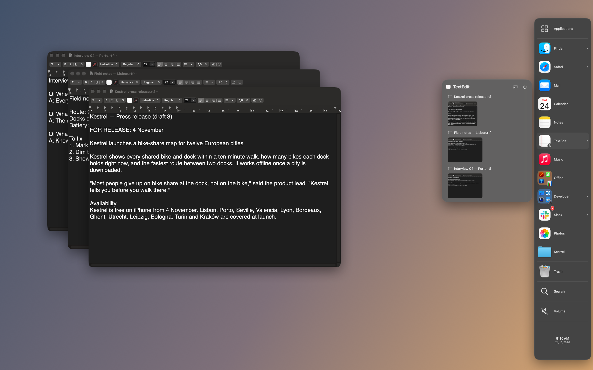

Rest the pointer on a running app and a flyout lists its windows. Click a window to bring it to the front.

## When to use it

- An app has several windows and you want one of them.
- You want to see a window before you switch to it.
- You want to bring back a window you minimized.

## How to use it

### Open the flyout

1. Rest the pointer on a running app. The flyout opens after the **Hover delay**, 0.5 seconds by default.
2. Click a window to bring it forward.
3. Move away to close it.

Window titles need Accessibility. Without it, the flyout asks for the permission instead of listing windows. If an app has none, it says "No windows".

### Thumbnails

Thumbnails need Screen Recording, which is optional. Without it you get titles only. Under the list the flyout may ask **Enable window previews?** Choose **Enable** to be asked by macOS, or **No Thanks** to keep titles only.

### Header buttons

- **New window** presses the app's New Window command, usually the ⌘N item in its File menu. It does nothing in an app that has no such item.
- **Quit** followed by the app's name asks for confirmation first, then quits the app.

### Show all windows

Right-click a running app and choose **Show All Windows** to open the flyout without waiting.

### Settings

In Settings > Behavior:

- **Show window previews on hover** turns the hover flyout on or off.
- **Hover delay** sets how long the pointer rests first.
- **Panel size** is **Small**, **Medium** or **Large**. It sizes the flyout cards and the now-playing panel.
- **Clicking an icon** can be set to **Shows its windows**, so a click opens the flyout.

### Minimized windows

Windows you minimize appear as rows before the Trash, up to three, newest first. Click one to restore it. Right-click it for **Restore**. Older ones stay in the app's flyout. Turn this off with **Minimized windows** in Settings > Bar. It needs Accessibility.

### Window counts

An app with two or more windows shows a number on its icon. Turn it off with **Window count badges** in Settings > Bar. The count needs no permission.

## What it will not do

- It does not read what is in your windows. Thumbnails are small pictures, taken only for the flyout.
- Without Accessibility, you still get window counts, but no titles, no flyout list and no minimized rows.
- It does not move, resize or close windows. To see every window at once, use the [Window switcher](../windows/window-switcher.md).

## Next steps

- [Applications](applications.md)
- [Window switcher](../windows/window-switcher.md)
- [Privacy and permissions](../reference/privacy-and-permissions.md)
- [Troubleshooting](../reference/troubleshooting.md)
