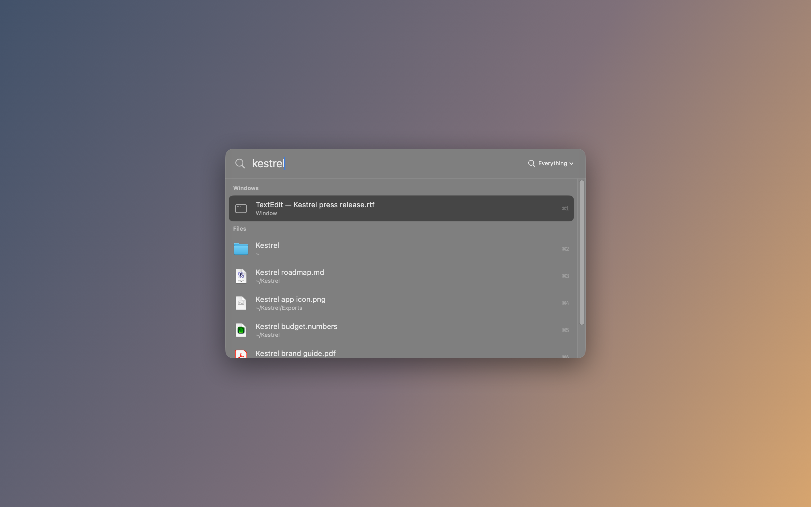

Search lists apps, windows, files, System Settings panes and actions in one place.

## When to use it

- You want to open an app without reaching for the bar.
- You want to jump to a window or a file by name.

## How to use it

### Search

1. Press <kbd>⌥</kbd><kbd>Space</kbd>. If you chose another shortcut in setup, use that.
2. Type part of a name.
3. Use the arrow keys to pick a result, or press <kbd>⌘</kbd> and a number from 1 to 9 for the row with that number.
4. Press Return to run it.

### Narrow it with a scope

The scope shows at the right of the field and starts on **Everything**.

1. Press <kbd>⇥</kbd> to move to the next scope, or choose one from the menu.
2. Or press <kbd>⌃</kbd>1 to <kbd>⌃</kbd>6 for a scope directly.

The scopes are **Everything**, **Applications**, **Files & Folders**, **Files**, **Folders** and **Settings & Actions**. The scope goes back to **Everything** each time search opens.

> [!NOTE]
> Window results need Accessibility. Without it, apps, files and actions still work. See [Privacy and permissions](../reference/privacy-and-permissions.md).

## What it will not do

- It does not search the contents of your files, only their names.
- It does not send what you type anywhere.

## Next steps

- [Search](../search/search.md)
- [Window switcher](../windows/window-switcher.md)
- [Keyboard shortcuts](../reference/keyboard-shortcuts.md)
