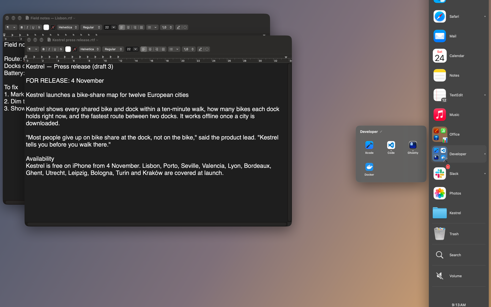

A bar with many apps can be tamed with groups, folder stacks and a little pruning.

## When to use it

- The bar has more icons than you use.
- You want related apps in one place.

## How to use it

### Make a group

1. Drag one app icon onto another and hold it there.
2. Let go. The two become a group, named after the apps' category.
3. Click the group to open it. You can rename it from the title.

To take an app out, right-click it in the open group and choose **Remove from Group**. See [Groups](../bar/groups.md).

### Pin a folder

1. Drag a folder from Finder onto the bar.
2. Click it to see its contents on a grid beside the bar.

See [Folder stacks](../bar/folder-stacks.md).

### Know the zones

The top and the end of the bar stay fixed. The middle holds your apps and scrolls once it is full. So a long list never pushes Trash or Search out of reach.

### Remove an icon

- Right-click a pinned app and choose **Unpin**.
- Or drag it off the bar.
- For a pinned folder, right-click and choose **Remove from Bar**.

## What it will not do

- Unpinning an app does not quit it or delete it.
- Removing a folder from the bar does not delete the folder.

## Next steps

- [Applications](../bar/applications.md)
- [Groups](../bar/groups.md)
- [Folder stacks](../bar/folder-stacks.md)
