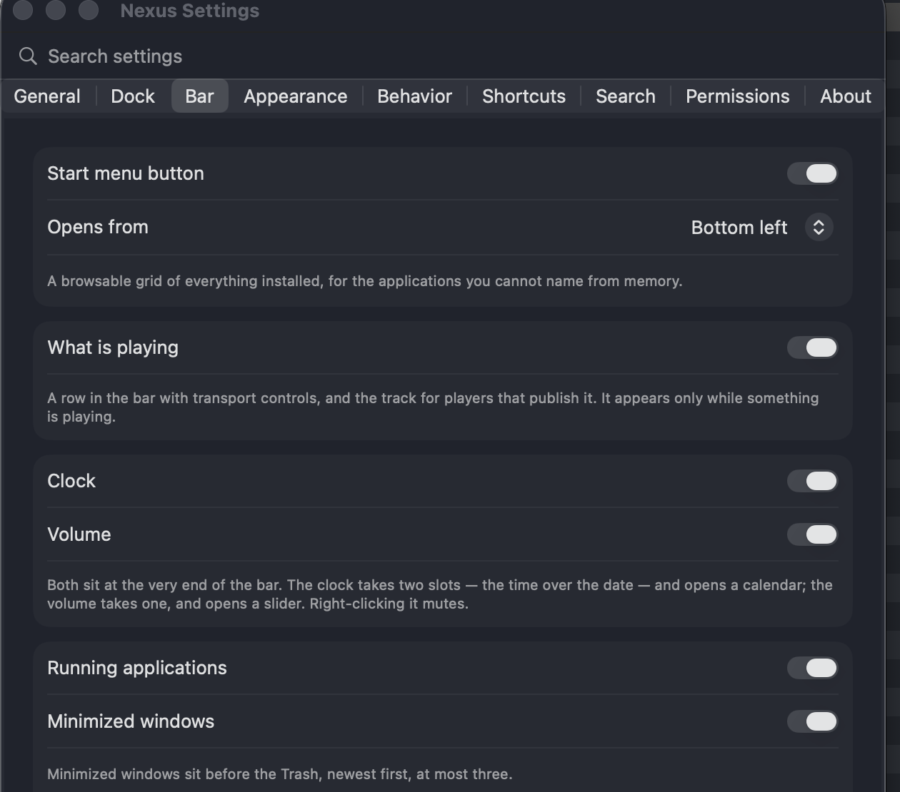

Open Settings from the Nexus menu bar item (**Settings…**, or <kbd>⌘</kbd>, ). Everything applies at once; nothing needs a restart.

## Search settings
The field above the tabs is **Search settings**. Type a word and the matching options are listed with their tab. Click one, or press Return for the first, to jump to its tab.

## General
| Option | What it changes |
|---|---|
| **Launch Nexus at login** | Starts Nexus when you log in. Nexus should be in Applications first. |
| **Show Nexus in the menu bar** | Shows or hides the Nexus item in the menu bar. |
| **Enable the global shortcut** | Turns the search shortcut on or off. |
| **Run Setup Again…** | Reopens the setup steps. |

## Dock
| Option | What it changes |
|---|---|
| **Nexus is** | **My Dock** hides the macOS Dock while Nexus runs and restores it when Nexus quits. **A sidebar** leaves the macOS Dock alone. |
| **Position** | **Left**, **Right**, **Top** or **Bottom**. |
| **Launch Nexus at login** | Same switch as in General. |
| **macOS Dock** | Shows whether the Dock is **Hidden by Nexus** or **Visible**. |
| **Restore macOS Dock** | Brings the Dock back now, if a crash left it hidden. |
| **Display** | **Main display**, **Display with the pointer**, or **Every display**. |

## Bar
| Option | What it changes |
|---|---|
| **Start menu button** and **Opens from** | A button that opens a grid of every installed app, from a chosen corner. |
| **What is playing** | A row with playback controls, shown only while something plays. |
| **Clock**, **Volume** | The clock and volume controls at the end of the bar. |
| **Running applications** | Shows apps that are open but not pinned. |
| **Minimized windows** | Shows up to three minimized windows before the Trash. |
| **Window count badges** | Shows how many windows an app has. |
| **Hide over full-screen apps** | Hides the bar on a display showing a full-screen window. |
| **Show folder preview on hover** | Hovering a folder shows its contents. Off, a click opens it. |
| **Suggest groups by category** | A newly pinned app can join the group its category already has. |
| **Group colours and emoji** | Shows or hides group colours and emoji. |
| **Most pinned rows**, **Most running rows** | Limits how many rows show. **Fit the screen** shows as many as fit. |

## Appearance
| Option | What it changes |
|---|---|
| **Sidebar width**, **Icon size**, **Icon spacing**, **Corner radius**, **Opacity** | Sliders for the look of the bar. |
| **Media player** | **Wide** or **Compact**. |
| **Wide player shows** | **Progress bar** or **What is playing**. |

## Behavior
| Option | What it changes |
|---|---|
| **Auto-hide the sidebar**, **Hide delay** | Slides the bar away until the pointer returns. |
| **Expand on hover** | The bar grows on hover. Not available on the top or bottom edge. |
| **Show window previews on hover**, **Hover delay** | Shows an app's windows when you rest on it. |
| **Panel size** | **Small**, **Medium** or **Large** hover panels. |
| **Keep windows off Nexus** | Moves windows that open under the bar. Needs Accessibility; off while auto-hide is on. |
| **Applications per group** | **9 (3 × 3)** or **16 (4 × 4)**. |
| **Opened group shows** | **Icons** or **A list**. |
| **Clicking an icon** | **Activates or launches the app** or **Shows its windows**. |

## Shortcuts
| Option | What it changes |
|---|---|
| **Open search** | The key for the palette, default <kbd>⌥</kbd><kbd>Space</kbd>. |
| **Keyboard access to the bar**, **Focus the bar** | Turns the bar's keyboard mode on and sets its key. |
| **Window switcher**, **Open the switcher** | Turns the switcher on and sets its key. |

Click a shortcut box and press the new keys. <kbd>⌫</kbd> resets, <kbd>Esc</kbd> cancels. If two shortcuts match, a red warning appears. See [Keyboard shortcuts](keyboard-shortcuts.md).

## Search
| Option | What it changes |
|---|---|
| **In the bar, show** | **An icon**, **A search box** or **Nothing**. |
| **Search applications**, **Search windows**, **Search files**, **Search actions** | Which kinds of result appear. |
| **Maximum results** | From 5 to 50, in steps of 5. |

## Permissions
Shows **Accessibility** and **Screen Recording**, each marked **Granted** or **Not granted**, with **Open System Settings**. See [Privacy and permissions](privacy-and-permissions.md).

## About
Shows the version, author, licence and where Nexus is running from. **Copy Version Details** copies a short summary to paste into a bug report.

## Next steps
- [Keyboard shortcuts](keyboard-shortcuts.md)
- [Privacy and permissions](privacy-and-permissions.md)
- [Position and displays](../bar/position-and-displays.md)
- [Use Nexus instead of the Dock](../recipes/replace-the-dock.md)
