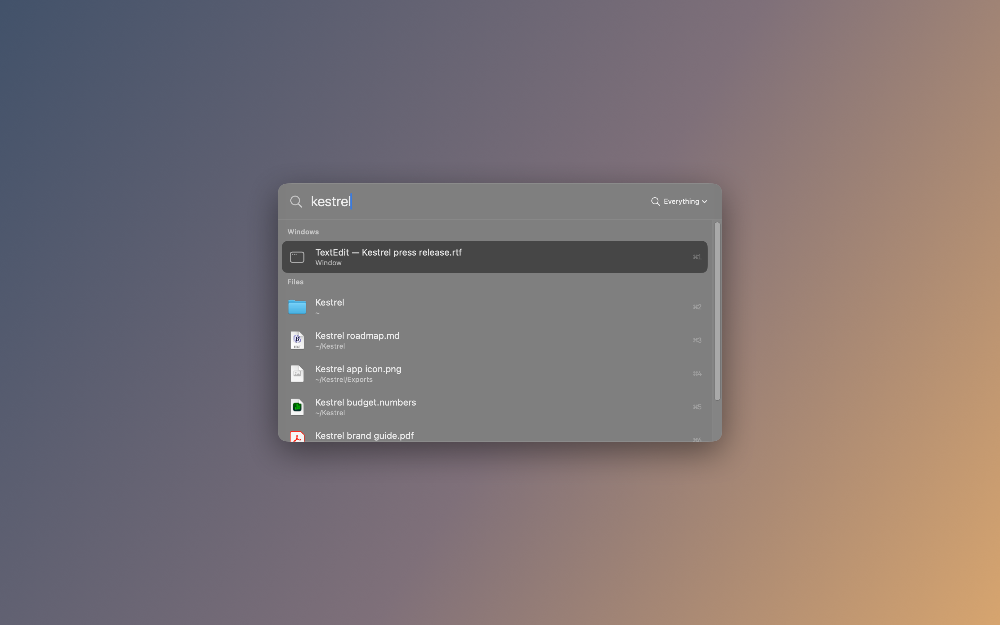

The search palette finds applications, open windows, files, folders, System Settings panes and a few actions from one box. Open it from anywhere, type a few letters and press Return.

## When to use it
- You know what you want but not where it is: an app, a document, a window you lost.
- You want a System Settings pane without opening System Settings and scrolling.
- You want to quit an app, lock the screen or open Downloads from the keyboard.

## How to use it
### Open the palette
1. Press <kbd>⌥</kbd><kbd>Space</kbd>. The palette opens in the middle of the screen.
2. Or click the Search part of the bar. Settings ▸ **Search** ▸ **In the bar, show** chooses how it looks: **An icon** (opens the palette in the middle of the screen), **A search box** (opens it beside the box) or **Nothing** (the bar has no Search part; the shortcut still works).
3. Or choose **Search…** from the Nexus menu bar item.

You can change the shortcut in Settings ▸ **Shortcuts** ▸ **Open search**. See [Keyboard shortcuts](../reference/keyboard-shortcuts.md).

### Find something and run it
1. Type part of the name. Results appear in groups: **Applications**, **Windows**, **Actions**, **Files**.
2. Use <kbd>↑</kbd> and <kbd>↓</kbd> to move. The first result is already selected.
3. Press <kbd>Return</kbd> to run the selected result, or press <kbd>⌘</kbd>1 to <kbd>⌘</kbd>9 to run the result with that number. The number is shown at the right of each row.
4. Press <kbd>Esc</kbd> to leave. If a scope is set, the first <kbd>Esc</kbd> goes back to **Everything** and the second closes the palette.

With nothing typed, the palette lists the applications you used most recently.

### What each result does
| Result | Return does |
|---|---|
| Application | Opens it, or brings it to the front if it is running. |
| Window | Brings that window to the front. |
| File or folder | Opens it. <kbd>⌥</kbd><kbd>Return</kbd> opens the folder that holds a file. |
| System Settings pane | Opens that pane. |
| Action | Runs it. |

### Narrow a search with a scope
The chip at the right of the box shows the current scope. Click it for a menu, or use the keyboard.

| Scope | Key |
|---|---|
| **Everything** | <kbd>⌃</kbd>1 |
| **Applications** | <kbd>⌃</kbd>2 |
| **Files & Folders** | <kbd>⌃</kbd>3 |
| **Files** | <kbd>⌃</kbd>4 |
| **Folders** | <kbd>⌃</kbd>5 |
| **Settings & Actions** | <kbd>⌃</kbd>6 |

Press <kbd>⇥</kbd> to move to the next scope, <kbd>⇧</kbd><kbd>⇥</kbd> to go back. The palette starts on **Everything** every time it opens. Window results only appear in **Everything**.

### Built-in actions
Type the name of any of these:
- **Open Terminal**
- **Open Downloads**
- **Open Documents**
- **Open Home**
- **Open System Settings**
- **Lock Screen**
- **Quit** followed by the name of any running app, for example Quit Safari. It asks the app to quit politely.

System Settings panes (Displays, Sound, Keyboard and so on) are listed with the subtitle **System Settings**.

### Choose what is searched
In Settings ▸ **Search**, turn **Search applications**, **Search windows**, **Search files** and **Search actions** on or off. **Maximum results** sets how many rows show, from 5 to 50.

## How ranking works
Nexus remembers what you run and moves it up next time. It keeps the last 500 results you used, on this Mac, and forgets the least recent ones first.

## What it will not do
- Window results need Accessibility. Without it the palette still finds apps, files, actions and Settings panes. See [Privacy and permissions](../reference/privacy-and-permissions.md).
- File search uses the Spotlight index and skips your Library folder.
- The bar cannot take typing. You type in the palette, even when the bar shows a search box.
- If you set the shortcut to <kbd>⌘</kbd><kbd>Space</kbd>, macOS gives it to Spotlight first. Turn off Spotlight's shortcut in System Settings, as Settings ▸ **Shortcuts** explains.

## Next steps
- [Find any app, window or file](../recipes/find-anything.md)
- [Keyboard shortcuts](../reference/keyboard-shortcuts.md)
- [Window switcher](../windows/window-switcher.md)
- [Settings](../reference/settings.md)
