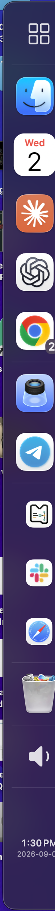

The first time Nexus opens, a short setup runs. Every step can be skipped, and you can run it again later.

## When to use it

- Right after you install Nexus.
- When you want to run setup again: choose **Run Setup Again…** from the menu-bar icon or in Settings › **General**.

## How to use it

### Go through setup

There are six steps. **Skip Setup** at the bottom ends it at any point and keeps safe defaults. **Back** and **Continue** move between steps.

1. **Welcome to Nexus.** A short introduction.
2. **Choose your search shortcut.** Pick **⌥ Space** (recommended, leaves Spotlight alone) or **⌘ Space** (needs one change in System Settings). Or record your own.
3. **Permissions.** Both are optional. Nexus works as a launcher and search palette with neither.
4. **Set up your sidebar.** Choose **Left**, **Right**, **Top** or **Bottom**, then tick the running apps to pin.
5. **Replace the macOS Dock.** Turn on **Use Nexus as primary Dock** if you want the Dock hidden while Nexus runs.
6. **You're set.** Click **Done**.

### Pin more apps

1. Drag an app from Applications in Finder onto the bar.
2. Or right-click a running app on the bar and choose **Pin**.
3. Drag icons to put them in the order you like.

### Try search

1. Press <kbd>⌥</kbd><kbd>Space</kbd> from any app.
2. Type a few letters of an app name.
3. Press Return to open the first result.

## What it will not do

- Skipping setup does not break anything. You still get search on ⌥Space and a bar with no pinned apps.
- It does not grant permissions for you. macOS asks you.

## Next steps

- [Applications](../bar/applications.md)
- [Search](../search/search.md)
- [Tidy a crowded bar](../recipes/tidy-the-bar.md)
