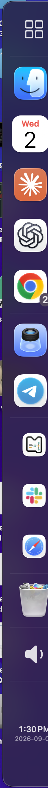

Nexus is a vertical dock and a search palette in one. It runs in the menu bar, keeps out of your way, and never changes your system settings.

## When to use it

- You want to know what Nexus does before you set it up.
- You want a quick map of which page explains which part.

## How to use it

### The tour

- **The bar.** A strip of icons on one edge of the screen. Pin your apps to it, launch them, and see which are running. See [Applications](../bar/applications.md).
- **Groups and folder stacks.** Drag one icon onto another to make a group. Pin a folder to open its contents on a grid. See [Groups](../bar/groups.md) and [Folder stacks](../bar/folder-stacks.md).
- **Windows on the bar.** Rest the pointer on a running app to see its windows. See [Windows on the bar](../bar/windows.md).
- **Media, clock, volume and Trash.** Rows at the end of the bar. See [Media, clock, volume and Trash](../bar/media-clock-volume.md).
- **Search (⌥Space).** One list for apps, windows, files, System Settings panes and actions. See [Search](../search/search.md).
- **Window switcher (⌥Tab).** Every window as a card. See [Window switcher](../windows/window-switcher.md).
- **Keyboard control (⌃⌥Space).** Put the keyboard on the bar and walk it with the arrow keys. See [Control the bar from the keyboard](../windows/keyboard-control.md).
- **Settings.** Every option, in tabs. See [Settings](../reference/settings.md).
- **The menu-bar icon.** Click it for **Search…**, **Hide Nexus Bar** or **Show Nexus Bar**, **Settings…**, **Run Setup Again…** and **Quit Nexus**. If you use Nexus instead of the Dock, it also shows **Restore macOS Dock**.

> [!NOTE]
> Everything stays on this Mac. Nexus has no account and sends nothing anywhere. See [Privacy and permissions](../reference/privacy-and-permissions.md).

## What it will not do

- It does not need any permission to start. Window features need Accessibility, and thumbnails can use Screen Recording; both are optional.
- It does not replace the Dock unless you turn that on.

## Next steps

- [Install Nexus](install.md)
- [Your first five minutes](first-five-minutes.md)
- [Position and displays](../bar/position-and-displays.md)
