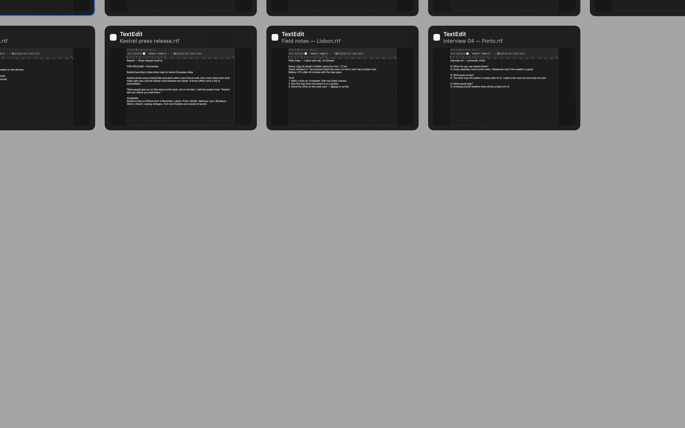

The window switcher shows every open window as a card, one card per window, not one per app. Pick a card to go to that window.

## When to use it
- An app has many windows and you want a particular one.
- You want to see everything open on the Mac at once.
- You want to turn several open apps into a group on the bar.

## How to use it
### Open it and pick a window
1. Press <kbd>⌥</kbd><kbd>Tab</kbd>. A grid of cards covers the screen.
2. Press <kbd>⌥</kbd><kbd>Tab</kbd> again, or <kbd>⇥</kbd>, to move to the next card. Or use the arrow keys.
3. Press <kbd>Return</kbd>, or click a card, to go to that window.
4. Press <kbd>Esc</kbd> to close without switching. If the filter has text in it, the first <kbd>Esc</kbd> clears it.

You can change the shortcut, or turn it off, in Settings ▸ **Shortcuts** ▸ **Window switcher**.

### Filter
Type in the **Filter…** box. Every word you type must match the app name or the window title, so "saf goo" finds a Google window in Safari.

### Sort
Choose **Recent Apps**, **Application** or **Window Title** in the **Sort** menu. The arrow button (**Reverse the order**) flips the order.

### Group
The three buttons at the left of the toolbar group the cards: **Flat**, **By Application** or **By Display**. Nexus remembers your sort, grouping and direction.

### Close a window
Press <kbd>⌘</kbd><kbd>W</kbd> to close the focused window. Or hover a card and click its close button (**Close window**).

### Make a group from windows
1. <kbd>⌘</kbd>-click each card you want. A card you picked is marked as selected.
2. Click **Add Stack**.
3. The apps of those windows are added to the bar as one group. Several windows of one app add that app once.

A group holds applications, not windows, because a window does not survive a relaunch. See [Groups](../bar/groups.md).

## What it will not do
- It needs Accessibility to list windows. Without it the switcher shows a prompt instead of cards.
- Thumbnails need Screen Recording, which is optional. Without it each card shows the app's icon. If Screen Recording is off, a banner offers **Open Settings…** or **Not Now**. Choosing **Not Now** hides it until Nexus is restarted.
- Closing a window is the app's own close. An app may ask to save first.

## Next steps
- [Keyboard shortcuts](../reference/keyboard-shortcuts.md)
- [Windows on the bar](../bar/windows.md)
- [Privacy and permissions](../reference/privacy-and-permissions.md)
- [Search](../search/search.md)
